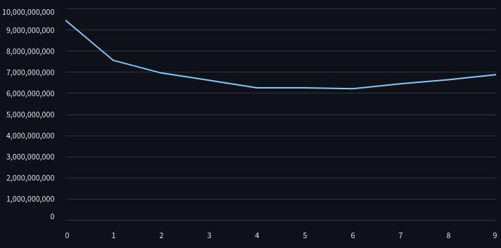

# California housing with decision tree

In this project I have applied Decision tree fro mscratch in [California Housing](https://www.kaggle.com/datasets/camnugent/california-housing-prices) dataset in kaggle from it's notebook, trained it, stored the parameter and showed the preview in streamlit app. This markdown is just the preview of the project and how I made this. I have given more details in m [notes](https://github.com/gitbhusalhubpramish/ml-notes/tree/main/0.004%20decision-tree) about decision tree.

This is what the losses(mse) of model in different depth looks like. I have rendered this in the [preview](https://california-housing-decision-tree.streamlit.app/)

## Small intro to Decision Tree

Decision Tree is a supervised meachine learning algorithm where it splits data using a treshold on and on untill it reach to leaf(prediction). It is usually classification model but I've made this regression and used MSE to calculate loss.

## Feature

This project was made by me to understand Decision tree form scratch so it has decision tree applied from scratch - trained in kaggle notebooks and preview in streamlit app. But also:

- Decision Tree from scratch
- GPU Parellized processing
- decision tree visulization
- trained in kaggle environment

## Tech-Stack

This project uses python liberies used for datascience - Visulization, calculation and data manipulation. I've used:

- Numpy for calculation
- Streamlit and graphviz for data visulization and preview
- cupy for GPU bashed parellel processing
- Pandas for data manipulation
- sk-learn for datasplit

